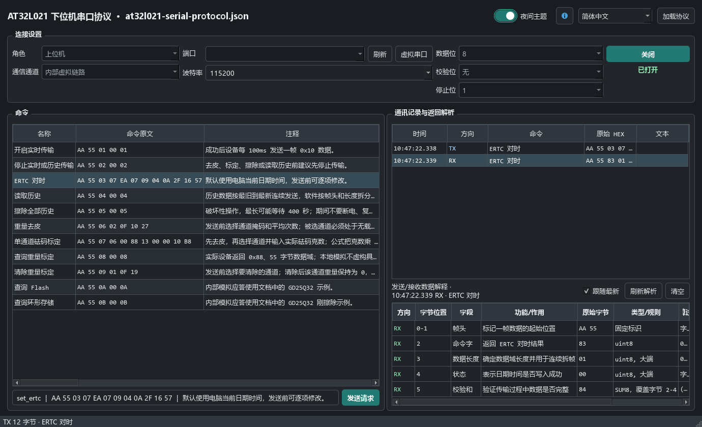
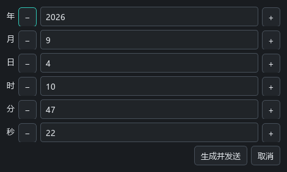

<p align="center">
  
</p>

<h1 align="center">串口协议助手 / Serial Protocol Assistant</h1>

<p align="center">配合 Skill，从原厂协议文档快速得到功能测试上位机<br>快速区分上位机、下位机和串口链路问题，也可直接作为轻量上位机使用<br>Turn vendor protocol documents into a working test console and isolate host, device, or link faults</p>

<p align="center">
  <a href="https://github.com/10walnut/serial-protocol-tester-app/stargazers"></a>
  <a href="https://github.com/10walnut/serial-protocol-tester-app/releases"></a>
  <a href="https://github.com/10walnut/serial-protocol-tester-app/releases/latest"></a>
  <a href="https://github.com/10walnut/serial-protocol-tester-app/actions/workflows/build-windows.yml"></a>
  <a href="https://github.com/10walnut/serial-protocol-tester-app/actions/workflows/cross-platform.yml"></a>
  <a href="https://github.com/10walnut/serial-protocol-tester-app/blob/main/LICENSE"></a>
</p>

<p align="center">
  <a href="https://ko-fi.com/B7J7268GW1"></a>
</p>

<p align="center">
  <a href="#中文">中文</a> · <a href="#english">English</a> ·
  <a href="https://github.com/10walnut/serial-protocol-tester-skill">协议转换 Skill</a> ·
  <a href="https://github.com/10walnut/serial-protocol-tester-app/releases/latest">下载最新版</a> ·
  <a href="#pip-安装--install-with-pip">pip 安装</a>
</p>



## 下载 / Downloads

| 版本 / Edition | 下载 / Download | 启动语言 / Default |
| --- | --- | --- |
| 中文版 · Windows 64 位 | [下载中文版 EXE](https://github.com/10walnut/serial-protocol-tester-app/releases/latest/download/SerialProtocolAssistant-ZH-CN.exe) | 中文界面 + 中文示例 |
| English · Windows x64 | [Download English EXE](https://github.com/10walnut/serial-protocol-tester-app/releases/latest/download/SerialProtocolAssistant-EN.exe) | English UI + English sample |

两个版本功能相同，均可在软件内切换语言，并分别记住语言选择。Both editions provide the same features and remember your language selection. User protocol annotations remain in the language of their JSON.

**Windows EXE 从安装到联调的 13 步图解：[中文使用说明](https://github.com/10walnut/serial-protocol-tester-app/blob/main/docs/user-guide/README.md) · [English guide](https://github.com/10walnut/serial-protocol-tester-app/blob/main/docs/user-guide/README.en.md) · [离线教程与全部配图 ZIP](https://github.com/10walnut/serial-protocol-tester-app/releases/latest/download/SerialProtocolAssistant-User-Guide.zip)**

图解以 Windows EXE 与 com0com 为例，两份图解末尾均有「跨平台补充」。Linux / macOS 与 pip 用户请先阅读下方 pip 章节。The illustrated guide uses the Windows EXE and com0com; both guides end with a cross-platform supplement. The offline ZIP is a release asset and is not shipped in the pip package or sdist.

## pip 安装 / Install with pip

支持 Windows、Linux、macOS（Python 3.10+）；运行时依赖 `PySide6-Essentials` 与 `pyserial`。Supports Windows, Linux and macOS (Python 3.10+) with `PySide6-Essentials` and `pyserial` as runtime dependencies.

```bash
python -m pip install serial-protocol-assistant   # 从 PyPI / from PyPI（发布后可用 / once published）
python -m pip install .                          # 从本地源码 / from a local clone
serial-protocol-assistant                        # 启动 / launch the GUI
serial-protocol-assistant --self-test            # 无需交互的自检 / non-interactive self-test
python -m serial_protocol_assistant --self-test  # 等价的模块入口 / equivalent module entry
python -m pip check                              # 校验依赖 / verify installed dependencies
```

- 从仓库安装 / From a clone: `python -m pip install git+https://github.com/10walnut/serial-protocol-tester-app.git`
- 开发模式 / Editable install: `python -m pip install -e .`
- 升级与卸载 / Upgrade and uninstall: `python -m pip install --upgrade serial-protocol-assistant` · `python -m pip uninstall serial-protocol-assistant`
- 构建 wheel 与 sdist / Build distributions: `python -m pip install -e ".[dev]"`（含 `build`）→ `python -m build` → `dist/*.whl` 与 `dist/*.tar.gz`
- 入口 / Entry points: `serial-protocol-assistant`（控制台 / console）、`serial-protocol-assistant-gui`（Windows 无控制台窗口 / no console window）、`python -m serial_protocol_assistant`
- Linux/macOS 一键源码启动 / One-step source launch: `bash start_serial_console.sh`（自动创建仓库根目录 `./.venv` 并以可编辑方式安装 / creates `./.venv` and installs the project in editable mode）

发布 / Publishing: `.github/workflows/cross-platform.yml` 目前只把 wheel/sdist 上传为 CI artifact，**不会自动发布到 PyPI**；需要发布时执行 `python -m pip install twine && python -m twine upload dist/*`，或配置 Trusted Publisher。CI currently uploads distributions as artifacts only; publishing remains a manual step.

### Linux / macOS 串口说明 / Serial ports on Linux / macOS

| 项目 / Item | 说明 / Notes |
| --- | --- |
| 端点 / Endpoint | Linux 常见 `/dev/ttyUSB0`、`/dev/ttyACM0`；macOS 优先 `/dev/cu.usbserial-*`，避免 `/dev/tty.*`。On Linux use `/dev/ttyUSB*` or `/dev/ttyACM*`; on macOS prefer `/dev/cu.*` over `/dev/tty.*`. |
| 权限 / Permissions | Linux 执行 `sudo usermod -aG dialout $USER`（部分发行版为 `uucp`）后重新登录；用 `ls -l /dev/ttyUSB*`、`lsof /dev/ttyUSB0`、`dmesg` 排查，必要时配置 udev 规则。不建议长期以 root 运行 GUI。Add your user to `dialout` (or `uucp`), log in again, inspect with `ls -l`, `lsof` and `dmesg`, and check udev rules; avoid running the GUI as root. |
| macOS 驱动 / Drivers | 优先使用 `/dev/cu.*`；安装 CH340 / CP210x / FTDI 等 USB 转串口驱动，并在「系统设置 → 隐私与安全性」中允许；随后重新拔插设备。Prefer `/dev/cu.*`, install the matching USB-to-serial driver, allow it in System Settings → Privacy & Security, then replug the device. |
| 虚拟串口 / Virtual pair | 点击“虚拟串口”会用系统内置 PTY 创建一对互联端点（如 `/tmp/serial-pair-xxx/ttyA` ↔ `ttyB`），无需 com0com / socat；点“释放端口对”或退出程序时自动清理。连接正在使用该端口对时，创建与释放会暂时锁定。The Virtual ports dialog creates a linked PTY pair (no com0com/socat needed), released manually or on exit; while a connection uses the pair, create/release is locked. |
| 无硬件 / No hardware | 端点填 `loop://` 即可本机回环测试。Use `loop://` for an in-process loopback. |
| 端点格式 / Endpoint format | POSIX 端点必须是绝对路径（`/dev/...` 或 PTY 链接），裸名 `ttyUSB0` 会被拒绝；URL 仅支持 `loop`、`socket`、`rfc2217`、`spy`、`alt`、`hwgrep`；macOS 的 `/dev/tty.*` 在对应 `cu.*` 存在时会自动改写。POSIX endpoints must be absolute paths (bare names are rejected), URLs use a whitelisted scheme, and macOS `/dev/tty.*` is rewritten to `/dev/cu.*` when available. |

端口列表会补充枚举常见 POSIX 设备并按 USB 适配器优先排序；打开串口失败时，软件会按平台给出权限、驱动与设备占用等排障提示。POSIX devices are enumerated and sorted with USB adapters first, and device/permission failures include a platform specific troubleshooting checklist.

pip 安装包不含 `release-defaults.json`，因此首次启动默认中文，可在界面右上角随时切换语言。The pip distribution has no release defaults file, so it starts in Chinese; use the in-app language selector to switch (an English default is injected only into the packaged EXE).

## 中文

首次启动默认开启夜间主题。使用顶部“夜间主题”开关可即时切换深色与浅色，软件会记住你的选择。主题切换不会断开连接、清空通讯记录或中断周期数据；参数输入、关于页和虚拟串口弹窗也会同步切换。

[查看浅色主题](https://raw.githubusercontent.com/10walnut/serial-protocol-tester-app/main/docs/images/app-main-light-zh.png)

新版本提供 `SerialProtocolAssistant-ZH-CN.exe`（中文版）和 `SerialProtocolAssistant-EN.exe`（英文版）。GitHub 仓库地址和 `serial_protocol.v1` 协议格式不变，已有协议 JSON 可继续使用。

Serial Protocol Assistant 读取标准 `serial_protocol.v1` JSON，把原厂协议里的命令、应答、变量公式和周期数据变成可直接操作的按钮。配套 Skill 负责从协议文档生成 JSON，本软件负责实际收发和解析，从资料到可用功能测试上位机无需重复编写临时界面与组帧代码。

它既能连接真实下位机，也能模拟下位机供其他上位机测试。对照协议预期、实际 TX 和实际 RX，可以快速判断问题来自上位机实现、下位机响应、协议定义还是串口链路；验证完成后，也可直接作为设备的简单功能上位机使用。

### 从原厂协议到功能测试

| 阶段 | 操作 | 结果 |
| --- | --- | --- |
| 1. 准备资料 | 上传原厂协议、命令表、示例帧或抓包 | 保留真实帧格式与时序 |
| 2. 转换协议 | 使用 [Serial Protocol Assistant Skill](https://github.com/10walnut/serial-protocol-tester-skill) | 得到校验通过的 `serial_protocol.v1` JSON |
| 3. 生成功能界面 | 在本软件中加载 JSON | 自动得到命令按钮、参数输入、应答规则和字段解释 |
| 4. 联机验证 | 连接真实设备、内部模拟器或虚拟端口对 | 直接测试功能并记录 TX/RX |
| 5. 定位问题 | 比较预期帧、TX、RX 和字段解析 | 快速区分上位机、下位机、协议脚本与链路问题 |

### 自定义变量组帧发送

Skill 会根据原厂协议，把日期、时间、设备地址、工作模式、阈值、标定值和传感器数据生成为可编辑变量，而不是把示例数据写死。每个变量都可以包含取值范围、单位、步进和计算公式；不同协议加载后会显示各自需要的输入项，形成更个性化的功能测试界面。



双击命令后可直接输入数值或使用加减按钮调整。点击“生成并发送”，软件会按 JSON 中的字节位置、大小端、比例和偏移公式完成编码，并重新计算帧长度与校验和；发送后的原始 HEX 和接收解析仍会完整记录，便于核对计算结果。

### 一分钟开始

1. Windows 用户从 [Releases](https://github.com/10walnut/serial-protocol-tester-app/releases/latest) 下载中文版 `SerialProtocolAssistant-ZH-CN.exe`；Linux / macOS 用户按上文 pip 安装。
2. Windows 平台运行软件并允许 UAC 提权；该权限用于创建和检查虚拟串口。EXE、pip 控制台入口和源码启动在 Windows 上都会请求提权，Linux / macOS 完全不需要。
3. 点击“加载协议”，选择 Skill 生成的 JSON 或自带的 `app/sample_protocol.json`。
4. 选择角色、通信通道和串口参数，点击“打开”，再双击命令开始测试。

> 没有协议 JSON？使用配套的 [Serial Protocol Assistant Skill](https://github.com/10walnut/serial-protocol-tester-skill) 读取 Word、Markdown、PDF、Excel、命令表或抓包并生成。

### 选择测试方式

| 目标 | 本软件角色 | 通信通道 | 对端 |
| --- | --- | --- | --- |
| 调试真实下位机 | 上位机 | 串口或 URL | 真实设备 |
| 测试自己开发的上位机（Windows） | 下位机 | COM10 等虚拟串口 | 上位机打开 COM11 |
| 测试自己开发的上位机（Linux/macOS） | 下位机 | PTY 对 `/tmp/serial-pair-xxx/ttyA` | 上位机打开 `/tmp/serial-pair-xxx/ttyB` |
| 单机验证协议按钮和应答 | 上位机 | 内部虚拟链路 | 软件内部模拟器 |
| 编写设备模拟程序 | 上位机 | `loop://` 或虚拟串口 | 测试程序 |

只需要常用命令收发时，可直接把本软件作为轻量上位机：加载协议、打开真实串口端点、填写参数并点击命令即可，不必启用虚拟串口或下位机模拟。

### 快速区分问题点

| 现象 | 优先检查 |
| --- | --- |
| 实际 TX 与协议预期不一致 | 协议 JSON 的模板、变量公式、校验范围和输入参数 |
| TX 正确，但对端没有收到 | 端点、波特率、接线、驱动和虚拟端口配对 |
| 对端收到请求，但没有生成应答 | 下位机命令匹配、固件处理和应答时序 |
| RX 原始字节正确，但字段显示错误 | JSON 的帧长、偏移、大小端、符号位和换算公式 |
| 内部模拟通过，真实设备失败 | 真实链路参数、硬件接线或设备实现 |

### 上位机连接真实设备

1. 用 USB 转串口连接设备，在 Windows 设备管理器确认 COM 号；Linux / macOS 用 `ls /dev/ttyUSB* /dev/ttyACM* /dev/cu.*` 确认端点路径。
2. 选择“上位机”和“串口或 URL”，选择对应端口；Linux/macOS 需填写完整 `/dev/...` 路径。
3. 波特率会从协议预加载，也可直接输入 50-4000000 范围内的值。
4. 打开连接后发送命令；TX、RX、原始 HEX 和命令名称会进入右侧记录。
5. 周期数据保持“跟随最新”即可自动显示最后一行；字段计算较多时点击“刷新解析”。
6. 取消“跟随最新”后可稳定查看历史帧，点击历史行即可重新解析该帧。

软件支持帧头、长度字段、分包、粘包、校验和、大小端、有符号值、比例换算和枚举。高频数据由接收队列分批处理，通讯记录保留最近 2000 条。

### 下位机模拟与多段回复

在“下位机”角色下，外部上位机发送的完整请求会匹配 `commands[].request`。软件先发送 `response`，随后执行 `follow_up_replies`；停止命令通过 `stop_streams` 取消周期数据。

```json
{
  "response": {"encoding": "hex", "data": "AA 55 81 01 00"},
  "follow_up_replies": [
    {
      "frame_ref": "realtime_data",
      "delay_ms": 100,
      "interval_ms": 100,
      "repeat_count": 0,
      "stream_id": "realtime",
      "prompt_variables": true
    }
  ],
  "auto_reply": true
}
```

`prompt_variables: true` 会先询问传感器或设定值，再按 JSON 中的公式组帧。`repeat_count: 0` 表示持续发送，直到命令的 `stop_streams` 包含相同 `stream_id`。

### 创建 COM10 ↔ COM11（仅 Windows / Windows only）

以下流程仅适用于 Windows 与 com0com；Linux / macOS 请直接使用上文「虚拟串口」的 PTY 端口对，无需驱动与管理员权限。Windows 用户态软件不能独立创建 COM 设备，本功能调用已安装的 com0com 驱动。推荐下载官方 [com0com 3.0.0.0 已签名版本](https://sourceforge.net/projects/com0com/files/com0com/3.0.0.0/com0com-3.0.0.0-i386-and-x64-signed.zip/download)。

1. 安装驱动并重启 Windows，在设备管理器确认没有黄色警告。
2. 软件中点击“虚拟串口”，确认 `setupc.exe` 路径。
3. 设置本软件端口 COM10、外部软件端口 COM11，点击“创建端口对”。
4. 只有两个端口都出现在“端口（COM 和 LPT）”且能被 pyserial 枚举时，软件才提示成功。
5. 本软件选择“下位机 + COM10”，待测试上位机选择 COM11；两端串口参数必须一致。

如果端口只出现在 `com0com - serial port emulators` 分类中，请删除旧端口对后重新创建。部分启用 Secure Boot 的 Windows 10/11 系统仍可能拒绝旧版驱动并显示代码 52；软件不会关闭系统签名验证。

### 从源码运行

Windows：

```powershell
git clone https://github.com/10walnut/serial-protocol-tester-app.git
cd serial-protocol-tester-app
.\start_serial_console.ps1          # 或双击 start_serial_console.bat
.\start_serial_console.ps1 -CheckOnly
.\build_serial_console.ps1          # -Language en 生成英文版
```

Windows 脚本首次运行会创建 `app/.venv` 并安装依赖；`build_serial_console.ps1` 另支持 `-SkipInstall`、`-ResetVenv`、`-OneDir`。Linux / macOS 运行 `bash start_serial_console.sh`（创建根目录 `./.venv`），或 `python -m pip install -e .` 后执行 `python -m serial_protocol_assistant`。

Linux / macOS 与 CI 一致的开发命令 / Dev commands used by CI on Linux/macOS:

```bash
python -m pip install -e ".[dev]"
python -m pip check
python -m unittest discover -s tests -p "test_*.py" -v
python -m serial_protocol_assistant --self-test
python -m build
```

打包脚本会生成多尺寸 Windows 图标、隔离 Qt DLL，并运行打包后的 `--self-test`。**仅 Windows 平台**启动会请求 UAC 提权（EXE、pip 入口与源码启动均如此）；Linux / macOS 完全不需要。默认输出 `dist/SerialProtocolAssistant-ZH-CN.exe`，`-Language en` 输出 `dist/SerialProtocolAssistant-EN.exe`；中文版同时保留 `dist/SerialProtocolAssistant.exe` 兼容入口。

## English

Dark mode is enabled on first launch. Use the **Dark theme** switch in the top bar to change themes immediately; the app remembers your choice. Switching does not disconnect the port, clear traffic, or interrupt periodic replies, and dialogs follow the selected theme.

Use `SerialProtocolAssistant-EN.exe` for the English edition or `SerialProtocolAssistant-ZH-CN.exe` for Chinese. Repository URLs and the `serial_protocol.v1` format are unchanged, so existing protocol files continue to work.

Serial Protocol Assistant is the runtime half of a fast path from vendor protocol documents to a working functional test console. The companion Skill produces validated `serial_protocol.v1` JSON; this app turns it into command buttons, editable parameters, response rules, live traffic, and byte-level explanations without rebuilding a temporary UI and parser for every device.

It connects to physical devices or emulates a device for another host application. Comparing the documented frame, actual TX, and actual RX helps isolate faults in the host, device, protocol definition, or serial link. Once validation is complete, the app can continue serving as a lightweight host for routine device functions.

### From Document to Test

| Stage | Action | Result |
| --- | --- | --- |
| 1. Collect sources | Provide the vendor specification, command tables, captures, and sample frames | Preserve the real framing and timing |
| 2. Convert | Run the [Serial Protocol Assistant Skill](https://github.com/10walnut/serial-protocol-tester-skill) | Produce validated `serial_protocol.v1` JSON |
| 3. Build the console | Load the JSON in this app | Get command buttons, inputs, replies, and field explanations |
| 4. Exercise the link | Connect hardware, the internal simulator, or a virtual port pair | Run functions and capture actual TX/RX |
| 5. Isolate the fault | Compare expected bytes, TX, RX, and decoding | Separate host, device, script, and transport problems |

### Protocol-Specific Variable Sending

The Skill converts changing dates, times, addresses, modes, thresholds, calibration values, and sensor samples into editable variables instead of freezing sample bytes. Each protocol can define its own inputs, ranges, units, steps, and formulas, giving the loaded console a device-specific workflow.


Open a command, type values or use the step controls, and select **Generate and Send**. The App encodes each value at the documented byte position with the configured endianness, scaling, and offset, then recalculates frame lengths and checksums. Raw TX and parsed RX remain available for verification.

### Quick Start

1. On Windows, download `SerialProtocolAssistant-EN.exe` from the [latest release](https://github.com/10walnut/serial-protocol-tester-app/releases/latest); on Linux/macOS use the [pip install](#pip-安装--install-with-pip) section above.
2. On Windows, approve the UAC prompt on first launch: the EXE, the pip console entry point and source launches all request elevation because virtual-port creation and diagnostics need it. Linux/macOS never request elevation.
3. Load a JSON file generated by the companion [Serial Protocol Assistant Skill](https://github.com/10walnut/serial-protocol-tester-skill), or use `app/sample_protocol.json`.
4. Select a role and transport, open the connection, then double-click a command.

### Test Workflows

| Goal | App role | Transport | Peer |
| --- | --- | --- | --- |
| Test a physical device | Host | COM port, `/dev/...` endpoint, or URL | Real device |
| Test your host application (Windows) | Device | Virtual COM10 | Host app on COM11 |
| Test your host application (Linux/macOS) | Device | PTY endpoint `/tmp/serial-pair-xxx/ttyA` | Host app on `/tmp/serial-pair-xxx/ttyB` |
| Validate JSON without hardware | Host | Internal virtual link | Built-in simulator |

For a physical device, select **Host**, choose the serial endpoint (a COM port on Windows or a full `/dev/...` path on Linux/macOS), verify baud/data/parity/stop settings, and send a command. Keep **Follow latest** enabled for live traffic. Repeated frames avoid automatic field calculations; select **Refresh details** when you need the latest byte-level explanation. Disable follow mode to inspect older frames.

In **Device** mode, a matched request sends `response` first and then runs `follow_up_replies`. An `interval_ms: 100` reply repeats every 100 ms, while a later command can cancel its `stream_id` through `stop_streams`.

On Windows, install the official [signed com0com package](https://sourceforge.net/projects/com0com/files/com0com/3.0.0.0/com0com-3.0.0.0-i386-and-x64-signed.zip/download), create COM10 ↔ COM11 in **Virtual ports**, open one side here, and open the other side in your host application. Both ports must appear under Windows **Ports (COM & LPT)**. On Linux/macOS, **Virtual ports** instead creates a linked PTY pair from built-in pseudo-terminals (no driver, no administrator access); use the two `/tmp/serial-pair-*/ttyA|ttyB` paths as the endpoints.

For routine command/response work, the app can be used directly as a lightweight host: load a protocol, open a physical serial endpoint, enter parameters, and run commands without configuring virtual ports or device simulation.

### Fast Fault Isolation

| Symptom | Check first |
| --- | --- |
| Actual TX differs from the documented frame | JSON templates, formulas, checksum coverage, and user inputs |
| TX is correct but the peer receives nothing | Endpoint selection, baud rate, wiring, driver, and virtual-port pairing |
| The peer receives the request but sends no reply | Device command matching, firmware handling, and response timing |
| Raw RX is correct but decoded fields are wrong | Frame length, offsets, endianness, signedness, and formulas in JSON |
| Internal simulation passes but hardware fails | Physical-link settings, wiring, or device implementation |

### Source and Packaging

Windows:

```powershell
git clone https://github.com/10walnut/serial-protocol-tester-app.git
cd serial-protocol-tester-app
.\start_serial_console.ps1
python -m unittest discover -s tests -p "test_*.py" -v
.\build_serial_console.ps1
```

On Linux/macOS run `bash start_serial_console.sh`, or `python -m pip install -e .` followed by `python -m serial_protocol_assistant`. `python -m build` produces a wheel and sdist; see the pip section above. Windows creates `app/.venv`, while the POSIX script creates `./.venv`. Virtual serial pairs use built-in PTYs instead of com0com, and the endpoint field accepts `/dev/...` paths. The offline illustrated guide is a release asset and is not bundled into the wheel or sdist.

The build script defaults to the Chinese edition, `dist/SerialProtocolAssistant-ZH-CN.exe`. Pass `-Language en` for `dist/SerialProtocolAssistant-EN.exe`. It embeds the multi-resolution icon, isolates Qt dependencies, and runs a packaged self-test. On Windows, normal startup requests UAC elevation for the EXE, pip entry points and source launches alike; Linux/macOS do not.

### Credits

Windows virtual COM support uses [com0com](https://sourceforge.net/projects/com0com/). Thanks to Vyacheslav Frolov and all contributors for the GPL Windows null-modem driver. This repository links to the official package and does not redistribute the driver. Linux/macOS virtual pairs use Python's built-in pseudo-terminal support and need no third-party driver.

### 许可 / License

本项目源码按照 [PolyForm Noncommercial License 1.0.0](https://github.com/10walnut/serial-protocol-tester-app/blob/main/LICENSE) 提供，仅允许非商业用途。个人学习、研究、实验和非商业组织使用请遵守许可证条款；公司业务、收费服务、产品集成、商业交付或其他商业用途，需要事先取得单独的商业授权。可通过 GitHub Issues 联系维护者。

This source code is available under the [PolyForm Noncommercial License 1.0.0](https://github.com/10walnut/serial-protocol-tester-app/blob/main/LICENSE) for noncommercial purposes only. Commercial use—including business operations, paid services, product integration, or commercial delivery—requires a separate license from the maintainer. Contact the maintainer through GitHub Issues.

The license change applies to versions released under the new license. Rights already granted for earlier MIT-licensed versions are not retroactively withdrawn.

Maintained by `十个核桃 / 10walnut`.
